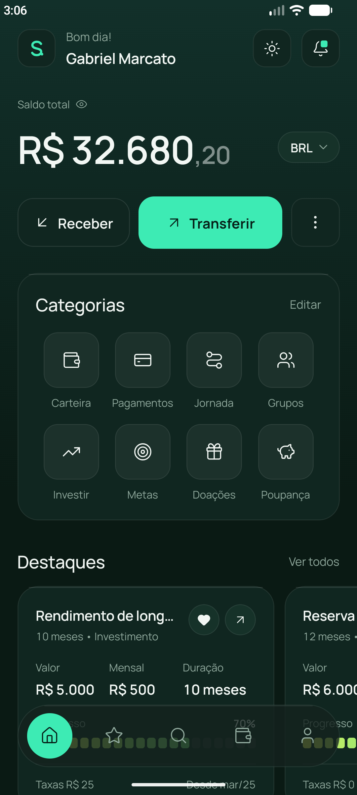
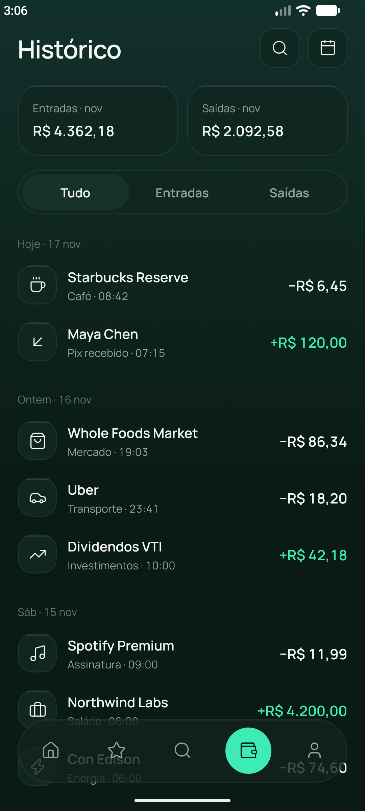
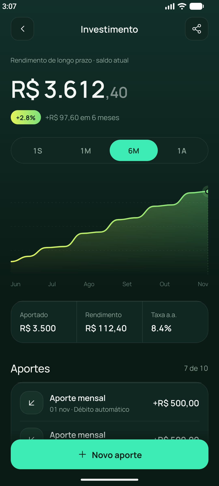
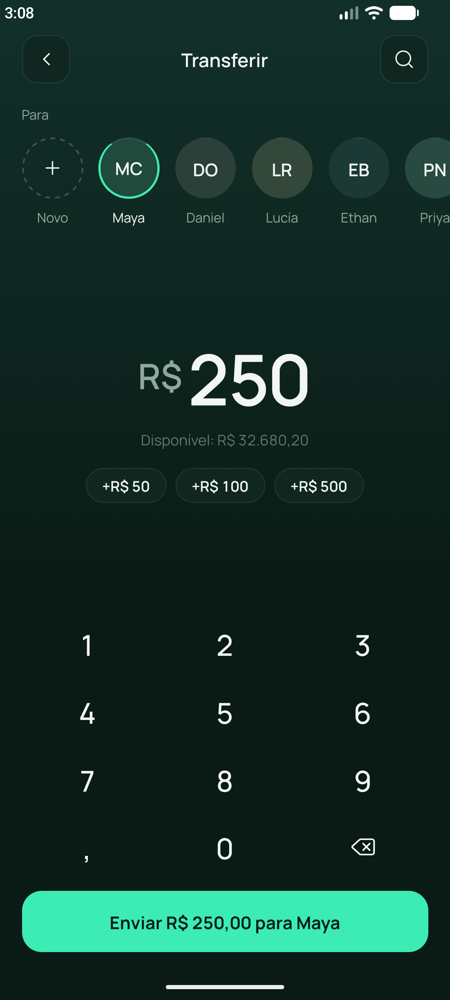
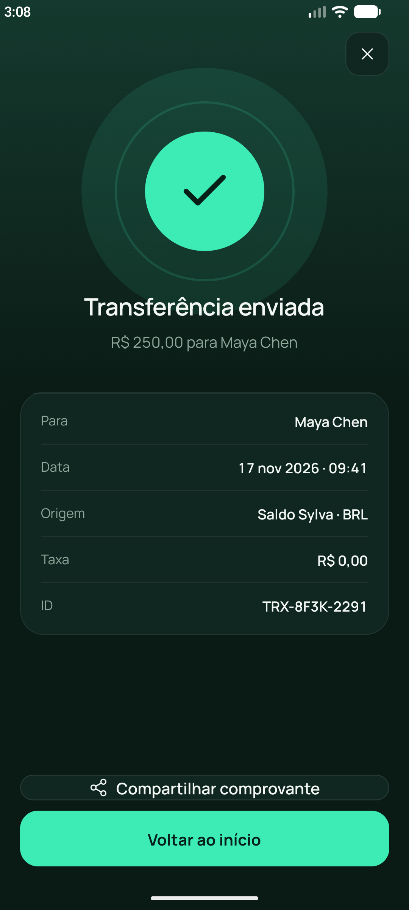

# Sylva Wallet

App de carteira digital (fintech) em dark mode, feito com React Native + Expo + TypeScript. Projeto de portfólio: a interface segue um design próprio, com profundidade construída por tom, vidro e luz. Não há integração com API; todos os valores são fictícios e fixos no código.

## Prévia

<p>
  
  
  
  
  
</p>

## Telas

- **Home:** saldo com opção de ocultar, ações rápidas, categorias e carrossel de destaques
- **Histórico:** resumo do mês, filtro Tudo/Entradas/Saídas e transações agrupadas por dia
- **Detalhe do investimento:** gráfico por período (1S/1M/6M/1A), resumo e lista de aportes
- **Transferir:** seleção de contato, teclado numérico próprio e valores rápidos
- **Sucesso:** check animado e comprovante da transferência

## Tecnologias

- Expo SDK 58 e Expo Router (navegação por arquivos)
- TypeScript (strict)
- react-native-reanimated (animações)
- react-native-svg (gráfico e logo)
- expo-linear-gradient e expo-blur (gradientes e vidro fosco)
- lucide-react-native (ícones)
- Manrope via `@expo-google-fonts/manrope`
- expo-haptics (feedback tátil)

## Como rodar

```bash
npm install
npx expo start
```

Escaneie o QR code com o Expo Go, ou use `npm run android` / `npm run web`.

## Estrutura

```
src/
  app/          rotas (abas, investimento, transferência, sucesso)
  components/   componentes de UI reutilizáveis
  lib/          formatação de moeda (BRL)
  data.ts       dados fictícios
  theme.ts      cores, raios e fontes
```
